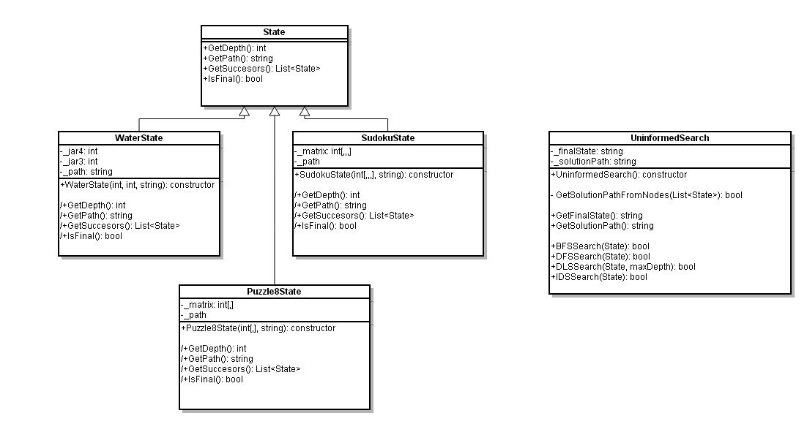

# Student guide: play with search algorithms

You have seen BFS, DFS, DLS, IDS and Greedy search on the whiteboard. This repository lets you **run them, break them, and build new ones**. Everything you learned in theory happens here for real: shortest solutions, infinite loops, memory blow-ups.

This guide has three parts:

1. **Experiments**: ten small labs to confirm the theory with your own eyes.
2. **Read the code**: a short tour, with questions.
3. **Build on top**: projects from "easy" to "research-level", plus a bug hunt.

> The code lives in [`csharp/`](../csharp). Build and run instructions are in [`csharp/README.md`](../csharp/README.md). Everything below is run from the `csharp` folder.



---

## The big picture

The framework separates **the problem** from **the algorithm**.

| Piece | Where | What it does |
|---|---|---|
| `State` | [State.cs](../csharp/Search.Backend/State.cs) | A node of the search tree. Knows its successors, whether it is a goal, its depth, its heuristic and the path that led to it. |
| `UninformedSearch` | [UninformedSearch.cs](../csharp/Search.Backend/UninformedSearch.cs) | BFS, DFS, DLS, IDS. |
| `InformedSearch` | [InformedSearch.cs](../csharp/Search.Backend/InformedSearch.cs) | Greedy best-first. |
| Problems | [Search.Common](../csharp/Search.Common) | Water jugs, Farmer-wolf-goat-cabbage ("Boat"), 8-puzzle, Sudoku. |
| Console | [Program.cs](../csharp/Search.Console/Program.cs) | Reads a problem and an algorithm from the command line and prints the solution. |

The key idea: **an algorithm never knows what problem it is solving.** It only calls `GetSuccessors()`, `IsFinal()` and `GetHeuristic()`. Add a new problem and every algorithm works on it for free.

---

## Part 1: Experiments

Every experiment is one command, run from the `csharp` folder:

```
dotnet run --project Search.Console -- --problem <water|boat|puzzle8|sudoku> --algorithm <bfs|dfs|dls|ids|greedy> [--depth N] [--board <digits>]
```

`--depth` is the depth limit for `dls` (default 10). `--board` gives a start board for `puzzle8` (9 digits) or `sudoku` (81 digits), row by row, with `0` for the blank or an empty cell. Press **Ctrl+C** to stop a run that never ends.

**`--board` is optional.** If you leave it out, the program uses a default start position:

| Problem | Default start |
|---|---|
| `water` | Both jugs empty. There is no `--board` for this problem. |
| `boat` | Everyone on the starting shore. There is no `--board` for this problem. |
| `puzzle8` | `123456078`, which is **two moves** from the goal. |
| `sudoku` | The sample board, `001078050782009400500100000008700060307801204010003500000002005005600942040380600`, with 34 given numbers. |

A board is written as digits **row by row**, with `0` for the blank (Puzzle8) or for an empty cell (Sudoku). For example, `123456078` is:

```
1 2 3
4 5 6
0 7 8
```

The program checks the length of the board (9 or 81 digits) and, for Puzzle8, that each digit from 0 to 8 appears exactly once. It does **not** check that the board can be solved, or that a Sudoku follows the rules. Both are good things to explore (see Lab 8 and the bug hunt).

Write down your **prediction before you run** each lab. That is where the learning happens.

### Lab 1: BFS finds the shortest solution

Run BFS on Water, Boat and Puzzle8:

```
dotnet run --project Search.Console -- --problem water --algorithm bfs
dotnet run --project Search.Console -- --problem boat --algorithm bfs
dotnet run --project Search.Console -- --problem puzzle8 --algorithm bfs
```


You should see solutions of **6**, **7** and **2** moves. These are the shortest possible, because BFS explores level by level.

*Think:* why is BFS guaranteed to be optimal here? What assumption about the cost of each move does it make?

### Lab 2: DFS can go into a cycle

Run the same three commands with `--algorithm dfs`.

**None of them finishes.** Watch the memory of the process in Task Manager while it runs: it keeps growing. DFS dives down one branch forever, going back and forth between the same states.

*Think:* what is the cycle in the Boat problem? (Follow by hand the *first* successor of each state, starting from the initial one.) Which one change to the algorithm would stop this? (Part 3 has the answer as a project.)

### Lab 3: ...but DFS works on Sudoku

Run:

```
dotnet run --project Search.Console -- --problem sudoku --algorithm dfs
```

It solves the sample board almost instantly, expanding fewer than 50 states.

*Think:* why is there no cycle in Sudoku? What does every move do to the board?

Then run it with `--algorithm bfs`. Both work here. Is that what you expected?

### Lab 4: DLS and the depth limit

Run DLS on Water with limits 5, 6, 8 and 12:

```
dotnet run --project Search.Console -- --problem water --algorithm dls --depth 8
```

In our runs:

| limit | moves in the solution found |
|---|---|
| 5 | no solution |
| 6 | 6 |
| 8 | 8 |
| 12 | 12 |

The same problem has a 6-move solution, but with a limit of 12 DLS returns a 12-move one. Boat and Puzzle8 behave the same way.

*Think:* DLS returns the **first** solution DFS finds inside the limit, not the best. Why are the extra moves always "wasted" back-and-forth steps? Why does the length always equal the limit, or the limit minus 1?

### Lab 5: IDS: the best of both

Run `--algorithm ids` on the three problems that DFS could not solve. You get the same 6, 7 and 2 moves as BFS, and the search always ends.

*Think:* IDS repeats the work of the upper levels again and again. Why is that repetition cheap in practice? What is its advantage over BFS in memory?

### Lab 6: Greedy needs a good heuristic

Run `--algorithm greedy` on `puzzle8`, which uses *misplaced tiles* as heuristic. On Water, Boat and Sudoku, `GetHeuristic()` returns `0` for every state, so Greedy behaves exactly like BFS there. Check it: the paths are identical.

Now try this start position:

```
1 5 2
4 8 _
7 6 3
```

```
dotnet run --project Search.Console -- --problem puzzle8 --algorithm bfs --board 152480763
dotnet run --project Search.Console -- --problem puzzle8 --algorithm greedy --board 152480763
```

BFS solves it in **7 moves**. Greedy, in our run, had not finished after 8 seconds. Let it run longer.

*Think:* Greedy is "informed" but it can still lose to an uninformed algorithm. Why? Can you find a start position where Greedy returns a *longer* solution than BFS?

### Lab 7: Tree search is wasteful

Try BFS on this position (`--board 236758014`):

```
2 3 6
7 5 8
_ 1 4
```

It needs at most 18 moves, but BFS had not finished after 8 seconds in our run. The 8-puzzle has only 181,440 reachable states, so why does BFS take so long?

*Think:* this framework is a **tree search**: it never remembers visited states, so the same board is generated again and again through different paths. Count how many times the starting board is generated.

### Lab 8: An unsolvable puzzle

Half of all 8-puzzle boards cannot be solved. Try `--board 213456780`:

```
2 1 3
4 5 6
7 8 _
```

(two tiles swapped). BFS never finds a solution, and it never stops by itself: the frontier keeps growing until the program runs out of memory. Notice that there are only 181,440 boards reachable from any start, so a smarter algorithm could prove in finite time that there is no solution.

### Lab 9: Order matters

In `Puzzle8State.GetSuccessors()`, swap the order of two moves (for example "up" and "down"). Run DLS or DFS again. Does the path change? Does the length change? Do BFS results change?

### Lab 10: Break a problem on purpose

Change the goal of Water (`IsFinal()` in `WaterState`) to `_jar4 == 3`, or to an impossible value like `_jar4 == 5`. Predict what BFS and IDS will do. Try it.

---

## Part 2: Read the code

You can read the whole search engine in half an hour. Start here:

1. [`UninformedSearch.cs`](../csharp/Search.Backend/UninformedSearch.cs). Compare `SearchBFS` and `SearchDFS` side by side. **What is the only real difference?** (Hint: the collection type.)
2. [`State.cs`](../csharp/Search.Backend/State.cs). Which methods must every new problem implement?
3. [`WaterState.cs`](../csharp/Search.Common/WaterState.cs). The smallest problem. Find where the *rules* of the game are written and where the *goal* is.
4. [`Search.cs`](../csharp/Search.Backend/Search.cs), method `TryFindSolution`. **When is the goal tested**: when a node is generated or when it is expanded? Does it matter for BFS? For other algorithms? (Think about this again in Part 3, project A\*.)
5. How does a state remember how it got there? Look at the `_path` string. Each state carries its own copy of the whole path, with no link to its parent. Why might that be good for memory in a tree search? What is the price?

---

## Part 3: Build on top

Pick a project. Each one is a real piece of AI search. ★ is easy, ★★★ is a challenge.

### Measure first (★)

Add counters: **nodes generated, nodes expanded, maximum size of the frontier**, plus the elapsed time (`Stopwatch`). Print them next to each solution. Now the labs above become numbers you can compare, and you can write a table of BFS vs DFS vs IDS.

### Compare everything at once (★)

Add `--algorithm all`: run every algorithm on the chosen problem and print one comparison table (moves, time, nodes). Careful: DFS may never finish, so each algorithm needs a **time limit**. How do you stop an algorithm that does not return?

### Add your own problem (★ to ★★)

Copy [`WaterState.cs`](../csharp/Search.Common/WaterState.cs) and change the rules. You need to implement `GetDepth`, `GetHeuristic`, `GetPath`, `GetSuccessors`, `IsFinal` (and `ToString` to print the final state). Ideas:

- Missionaries and cannibals.
- Towers of Hanoi.
- A maze on a grid with walls.
- N-queens (one queen per row).
- A 15-puzzle (4×4).
- Water jugs with different sizes: does a solution always exist?

### Better heuristics (★★)

Replace *misplaced tiles* in `Puzzle8State.GetHeuristic()` with the **Manhattan distance**. Give Water, Boat and Sudoku a real heuristic (for example, the distance of the 4-liter jar from 2 liters, or the number of empty Sudoku cells). Compare nodes expanded by Greedy before and after.

### Graph search (★★)

Add a **visited set** so the same state is never expanded twice. You will need a way to compare states, for example a `GetKey()` string, and a `HashSet<string>`.

Before you write any code, **predict**: what will happen to Labs 2, 7 and 8? Then check. A subtle point: what goes wrong if you combine DLS with a plain visited set? (Hint: a state reached first through a long path may block a shorter path to it.)

### Uniform-cost search (★★)

Give each move a cost (for example, filling a jug costs 3 and pouring costs 1). Store the accumulated cost in the state and expand the cheapest node first with a `PriorityQueue`. When does UCS behave exactly like BFS?

### A\* (★★★)

Expand the node with the smallest `f = g + h`, where `g` is the cost so far and `h` the heuristic. Compare with Greedy (uses only `h`) and with UCS (uses only `g`) on the 8-puzzle with Manhattan distance.

Two traps: A\* is only optimal if `h` is **admissible**, so test it. And the framework currently tests for the goal **when a node is generated**, which is not safe for A\*. Where must the test move, and why?

### Bonus ideas (★★★)

IDA\*, bidirectional search, beam search, or starting the TypeScript version of this framework in the (still empty) `typescript/` folder.

---

## Bug hunt

No code is perfect, and this repository is a good place to practice finding problems. For each point below, decide whether it is a **bug** or a **design choice**, and defend your answer. If it is a bug, write a failing test first, then fix it.

- `SearchIDS` has no upper bound. What happens on a problem with no solution?
- Sudoku `IsFinal()` only checks that no cell is empty. Is that enough? What if the starting board already has two equal numbers in a row?
- The class `Search` shares its name with the namespace `Search`. What problems does that cause?
- `GetDepth()` counts separators in a string. How expensive is that in a deep search?
- Every printed solution starts with an empty line. Why?
- Look at `GetSuccessors()` in each problem: can any rule generate an invalid state?

### Tests

The tests live in [`csharp/Search.Tests`](../csharp/Search.Tests) and run with:

```
dotnet test Search.FWK.sln
```

When you change an algorithm, run them. When you find a bug, add a test that fails before your fix and passes after.

---

## A tip for the whole course

Every algorithm in this repository is only a few dozen lines long. If something surprises you, add a `Console.WriteLine` and watch. The best way to understand a search algorithm is to watch the frontier change.

Have fun, and break things.
